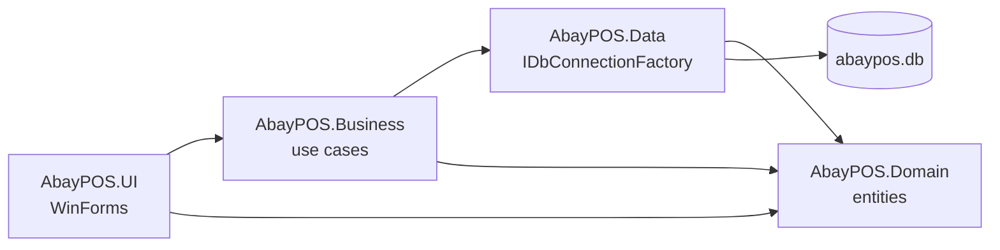

# AbayPOS (Minimart POS)

C# Windows Forms group project for **Windows Programming (COSC-4021)**, Unity University. Dark retail register for a neighbourhood minimart, with the native Windows title bar. SQLite today; the data layer is swappable so MySQL 8.4 can replace it later without touching UI or Business code.

## Group members

| Name | ID |
|---|---|
| Dibora Bogale | UUR01201/16 |
| Yisak Alemayehu | UUR01206/16 |
| Nehemiah Hosea | UUR01203/16 |
| Natnael Abebe | UUR08101/16 |
| Yordanos Alewond | UUR00751/17 |

## Setup

1. Install the [.NET 10 SDK](https://dotnet.microsoft.com/download).
2. From this folder:

```powershell
dotnet restore AbayPOS.sln
dotnet build AbayPOS.sln -c Debug
dotnet test AbayPOS.Tests
dotnet run --project AbayPOS.UI
```

On first launch the app creates `abaypos.db` next to the executable, applies `database/schema.sql`, seeds the catalog, and hashes the default users with PBKDF2.

## Default logins

| Role | Username | Password |
|---|---|---|
| Manager | `admin` | `admin123` |
| Cashier | `cashier` | `cashier123` |

Five wrong passwords lock the account. A manager unlocks it under **Users**.

## Architecture (4+1)

References flow **UI → Business → Data → Domain**. Forms never run SQL. Repositories never know about WinForms.



`Program.cs` is the composition root. It builds `AppHost`, which constructs the SQLite connection factory, unit of work, hasher, and services. Swap the factory there to change databases.

Money is `decimal` ETB in Domain/Business and **integer cents** in SQLite.

## UI

The shell uses the standard Windows caption, so snap, resize, and maximize behave like any other desktop app. Surfaces are solid colors from `Palette.Dark` (switch `Theme.Colors` to `Palette.Light` for the light set). There is no acrylic blur.

| Screen | What you see |
|---|---|
| Sign in | Centered card: username, password with show/hide, Sign in. Enter submits. Caps Lock is called out on the password field. |
| Register | Icon rail (Sales, History, Log out), product tiles, and a 420px cart. The status strip lists the shortcuts. |
| Payment | Cash or mobile money, quick amounts, live change. Confirm stays off until the amount covers the total. |
| Manager | 240px sidebar and list pages on one shared dark grid. |

Screenshots of the running screens are in `docs/screenshots/` when captured on a desktop session.

## Keyboard shortcuts (cashier)

| Key | Action |
|---|---|
| `F2` / `Ctrl+K` | Focus barcode / search |
| `Enter` | Add scanned item, or Pay |
| `+` / `-` | Change selected qty |
| `Del` | Remove selected line |
| `F4` | Discount |
| `Esc` | Cancel sale (confirm) |
| `F12` | Log out |

## Switching to MySQL 8.4 later

1. Add a `MySqlConnectionFactory : IDbConnectionFactory` in `AbayPOS.Data` (keep `SqliteConnectionFactory`).
2. Port `schema.sql` types (`INTEGER` → `BIGINT`, `TEXT` dates → `DATETIME(3)`, cents stay integers).
3. Point `AppHost.StartAsync` at the MySQL factory and connection string.
4. Do **not** change `AbayPOS.UI` or service method signatures. Business already talks only to `IUnitOfWork`.

## Tests

`AbayPOS.Tests` covers password hashing and lockout, cart totals and the 10% cashier discount cap, and `CompleteSaleAsync` rolling back when stock is insufficient.
